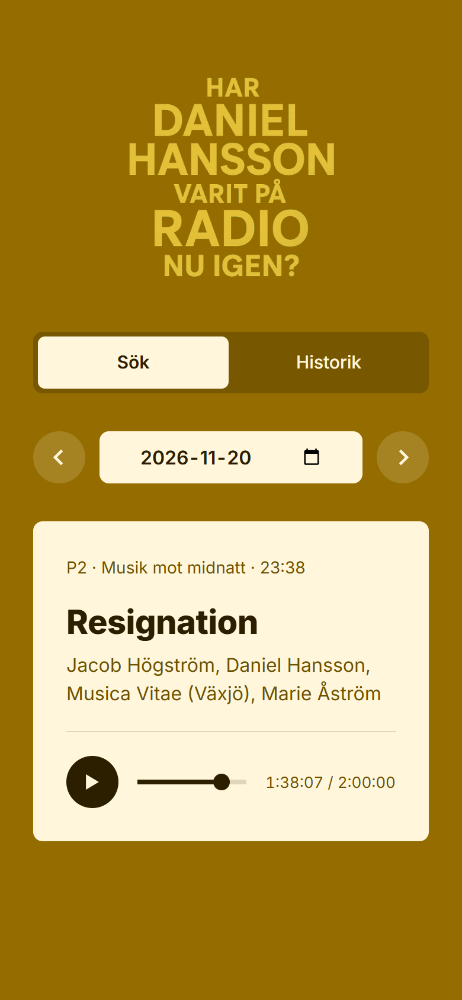
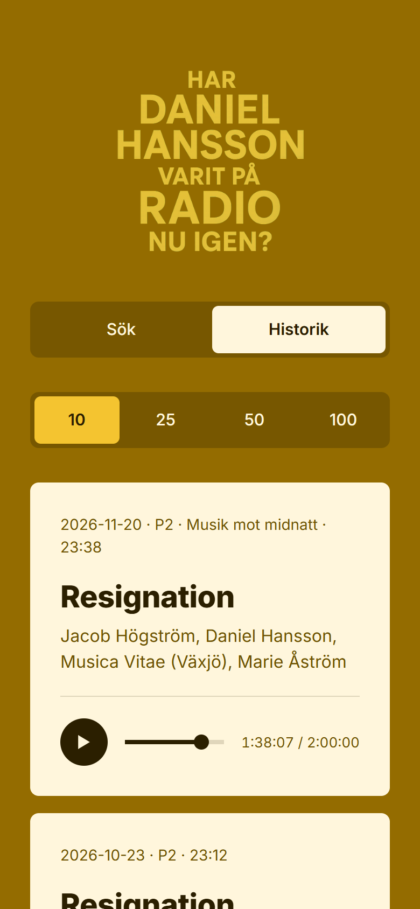

[](https://app.netlify.com/projects/relaxed-froyo-600ab8/deploys)

# Har Daniel Hansson varit på radio nu igen?

PWA for checking if Daniel Hansson's music has been played on Swedish public radio, using Sveriges Radio's open API.

[Latest deploy](https://relaxed-froyo-600ab8.netlify.app/)

## Screenshots

| Search | History (latest 10) |
| --- | --- |
|  |  |

Desktop layout, with the logo staying in view while the list scrolls:


## How it works

- **Search** picks a day, fetches the playlists of the configured channels from the Sveriges Radio API and keeps songs where the artist or title matches the filter. Channels and artist names are set in [src/config/filters.ts](src/config/filters.ts).
- Each day's result is cached in MongoDB through Netlify functions. Past days are loaded from that cache, while today is always fetched fresh.
- **History** lists the latest cached days that had matches (10, 25, 50 or 100).
- Audio is only available from Sveriges Radio for 30 days, so older finds show a note instead of a player.
- If there are no songs for the selected day, the app answers "Nej."

## Tech

React 18, TypeScript, Vite, plain CSS, Netlify Functions and MongoDB. Data comes from the [Sveriges Radio API](https://api.sr.se/api/documentation/v2/index.html).

## Development

```
npm install
npm run dev
```

`npm run dev` starts Vite only, so the Netlify functions are not available and the cache, saving and History tab will not work. To run everything locally:

```
npm run dev:netlify
```

and open http://localhost:8888. The functions need `MONGODB_URI`. Either run `npx netlify link` to use the Netlify site's environment variables, or create a `.env` file (it is gitignored):

```
MONGODB_URI=<your MongoDB connection string>
```

Other scripts:

| Command | What it does |
| --- | --- |
| `npm run build` | Production build to `dist/` |
| `npm run preview` | Preview the production build |
| `npm run lint` | Lint `src/` with ESLint |
| `npx tsc --noEmit` | Type-check |
| `npx jest` | Run the tests |

## Project structure

- [src/App.tsx](src/App.tsx): entry component, tabs and layout
- [src/components/](src/components/): UI components (date row, song card, audio player, history)
- [src/contexts/SongContext.tsx](src/contexts/SongContext.tsx): search state and fetching
- [src/services/SongService.ts](src/services/SongService.ts): Sveriges Radio API and Netlify function calls
- [netlify/functions/](netlify/functions/): serverless functions for reading and saving songs
- [src/index.css](src/index.css): all styling
